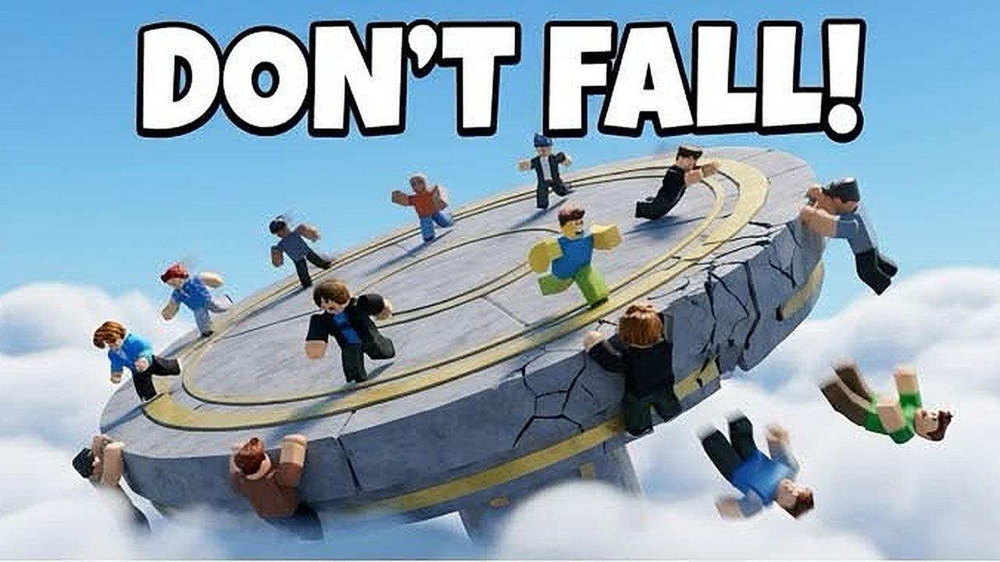

# Extreme Tilt! (Roblox)



**Play it:** https://www.roblox.com/games/118492233399605/Extreme-Tilt

A last-one-standing party game. Everyone stands on a giant floating plate that tilts toward wherever the weight is. You push other players off and dodge their pushes; a missed push makes you trip. The last one left on the plate wins.

- **Live and public** since Oct 15, 2026, with up to 15 players per server.
- **About 10,000 lines of Luau** (server, client, shared), built with [Rojo](https://rojo.space).
- **171 automated checks** run inside Roblox Studio before every release (the last run passed 210/210 test results).

## Features
- **Tilt physics.** The plate tilts toward the centre of mass of everyone standing on it, up to 40 degrees, with lurches, quakes, edge breaks and a shrinking plate late in the round.
- **Push / dodge / trip combat.** The server validates every push. A whiff trips the pusher, so spamming push gets you killed.
- **Bots that fill the plate up to 8 bodies,** so a solo player still gets a full round. Each bot leaves when a real player joins.
- **Last one standing.** The round ends about 1.2 s after only one body is left. Solo rounds never trigger this rule.
- **Ghosts.** Fallen players watch from above and drop junk on the people still standing, so they keep playing.
- **Economy.** Coins, 7-day login rewards, win streaks, a TOP WINS leaderboard, and cosmetics (trails, dances).
- **Monetisation.** 7 developer products (for example a nuke that blasts everyone else off, and a Second Chance revive) and a VIP game pass, all processed server-side.

## Engineering notes
- **Self-test harness.** `src/server/SelfTest.server.luau` runs only in Studio. It simulates full rounds, a crowded nuke, revives, purchases, last-one-standing and solo rounds, and prints PASS/FAIL.
- **Real bugs the tests caught:**
  - **Nuke:** a nuke buyer could get knocked off by the bots they had just blasted. Fixed by turning off collisions between blasted bots and the buyer.
  - **Solo round:** a lone body was unfrozen before it had settled on the plate.
- **Config in one place** (`src/shared/Config.luau`). Every value can be overridden through Workspace attributes, which the tests use to speed up rounds.
- **The camera favours a slight zoom over heavy screen shake,** so it's easier on phones.

## Layout
```
src/server   game loop, bots, physics, shop, data saving, self-test
src/client   input/push, HUD, shop UI, effects, ambience
src/shared   config, tilt maths, sounds, shop config
```
Build: `rojo build default.project.json -o Tilt.rbxlx`

## How this was built
I designed, directed, play-tested and shipped this project. Most of the code was written with an AI coding agent (Claude, running in the Hermes agent framework) working from my specs and bug reports, and I decided what to build, what to change and when to ship. Knowing how to use an AI agent to get from an idea to a live, tested product is the skill this repo shows.
